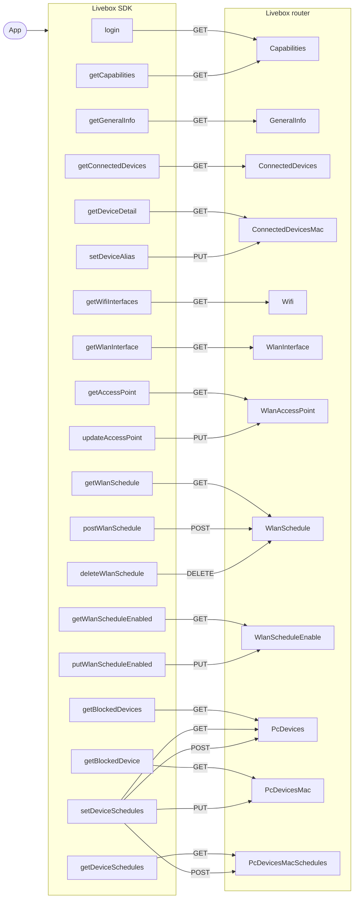

# Livebox Kotlin SDK

The **Livebox Kotlin SDK** is a SDK designed to interact with the Livebox family of routers through their API, using Kotlin programming language. It allows authentication, connected devices management, Wi-Fi configuration, parental controls and more, and features automatic fetching of capabilities for compatibility with this family of routers.
The schematics for the SDK are as follows, with each method linked to the router features it calls:


## Initialization
Initialization of the SDK is performed through the `LiveboxSdkBuilder`, which returns the `LiveboxSdk` object to interact with the router. This `LiveboxSdk` object will be the one to use for all other following operations.
```kotlin
val liveboxSdk = LiveboxSdkBuilder()
    .withContext(context = context)
    .withEnvironment(environment = environment)
    .build()
```

### Parameters
- `context`: `Context` — The current context where the initialization is set.
- `environment`: `Environment` — Defines whether to use the test or live API environment (`Environment.TEST` or `Environment.LIVE`).

### Network Configuration (Required for Android 17+)

**IMPORTANT for Android 17 (API 37) and higher:**

Android 17 introduces the `ACCESS_LOCAL_NETWORK` runtime permission to protect access to devices on the local network (including routers). The SDK declares this permission in its manifest (automatically merged), but **your app must request it at runtime**.

#### 1. Add Network Security Configuration

Create `res/xml/network_security_config.xml` in your app:

```xml
<?xml version="1.0" encoding="utf-8"?>
<network-security-config>
    <base-config
        cleartextTrafficPermitted="true" />
</network-security-config>
```

Then this would be referenced in the `application` level in the `AndroidManifest.xml`:

```xml
<?xml version="1.0" encoding="utf-8"?>
<manifest>
    <application
        ...
        android:networkSecurityConfig="@xml/network_security_config">
        ...
    </application>
</manifest>
```

**Note:** Livebox routers use HTTP (not HTTPS) and have dynamic IP addresses obtained via gateway detection, so we need to allow cleartext traffic globally for local network access.

#### 2. Request Runtime Permission (Android 17+)

```kotlin
import android.Manifest
import android.os.Build
import androidx.activity.result.contract.ActivityResultContracts

class MainActivity : ComponentActivity() {
    
    private val localNetworkPermission = registerForActivityResult(
        ActivityResultContracts.RequestPermission()
    ) { isGranted ->
        if (isGranted) {
            // Initialize SDK
            initializeLiveboxSdk()
        } else {
            // Handle permission denied
        }
    }
    
    override fun onCreate(savedInstanceState: Bundle?) {
        super.onCreate(savedInstanceState)
        
        // Request permission on Android 17+ (API 37)
        if (Build.VERSION.SDK_INT >= Build.VERSION_CODES.CINNAMON_BUN) {
            localNetworkPermission.launch(Manifest.permission.ACCESS_LOCAL_NETWORK)
        } else {
            initializeLiveboxSdk()
        }
    }
}
```

**See the sample app in this repository for a complete example.**

## Authentication
```kotlin
login(username: String? = null, password: String): Boolean
```
Attempts to log in using credentials. If invalid credentials are provided (HTTP 401), they are cleared and it returns `false`. Otherwise, capabilities are fetched and it returns `true`. `username` param is nullable, an in case it's not set, the default "UsrAdmin" value will be used.

## Capabilities
```kotlin
getCapabilities()
```
Fetches and caches the device capabilities (automatically invoked during `login()`).
It includes all features available for the given router. Note that those can change between versions. Additional to the ID, it returns the URI for the given feature, and the operations it allows.

## General Information
```kotlin
getGeneralInfo()
```
Retrieves general information about the device.

## Connected Devices
```kotlin
getConnectedDevices()
```
Returns a list of all currently connected devices.

```kotlin
getDeviceDetail(mac: String)
```
Retrieves details for a specific device identified by its MAC address.

```kotlin
setDeviceAlias(mac: String, alias: String)
```
Sets a custom alias for a connected device given its MAC address.

## Wi-Fi Configuration

```kotlin
getWifiInterfaces()
```
Fetches a list of available Wi-Fi interfaces.

```kotlin
getWlanInterface(wlanIfc: String)
```
Fetches details of a specific WLAN interface.

```kotlin
getAccessPoint(wlanIfc: String, wlanAp: String)
```
Retrieves configuration details for a specific access point.

```kotlin
updateAccessPoint(wlanIfc: String, wlanAp: String, accessPoint: AccessPoint)
```
Updates the configuration for a specific Wi-Fi access point. Used for changing the Wi-Fi's password.

## Wi-Fi Schedules

```kotlin
getWlanSchedule(wlanIfc: String, wlanAp: String)
```
Returns the list of `WeekDayHour` during which the network is off.

```kotlin
postWlanSchedule(wlanIfc: String, wlanAp: String, scheduleList: List<WeekDayHour>)
```
Adds new schedules to the network. They are combined with the existing ones, and the complete resulting list is returned.

```kotlin
deleteWlanSchedule(wlanIfc: String, wlanAp: String, scheduleList: List<WeekDayHour>)
```
Deletes the given schedules from the network, and returns the resulting list.

```kotlin
getWlanScheduleEnabled(wlanIfc: String, wlanAp: String)
```
Returns an `Enabled` object indicating whether the schedules are active for the network.

```kotlin
putWlanScheduleEnabled(wlanIfc: String, wlanAp: String, enabled: Enabled)
```
Enables or disables the schedules for the network, and returns the updated `Enabled` status.

## Parental Controls (Blocked Devices)
```kotlin
getBlockedDevices()
```
Returns a list of devices with blocking conditions (schedules, URLs).

```kotlin
getBlockedDevice(mac: String)
```
Gets detailed information about a device and its blocking conditions given its MAC address.

```kotlin
getDeviceSchedules(mac: String)
```
Retrieves the time-based blocking schedule for a device.

```kotlin
setDeviceSchedules(mac: String, schedules: List<WeekDayHour>)
```
Sets blocking schedules for a specific device.
If the device is not already in the blocked list, it is added first. Then, its status is set to `ENABLED` with a `SCHEDULE` mode, and the new schedule is posted.

## Minimum Requirements
Android 7.0 (API level 24)